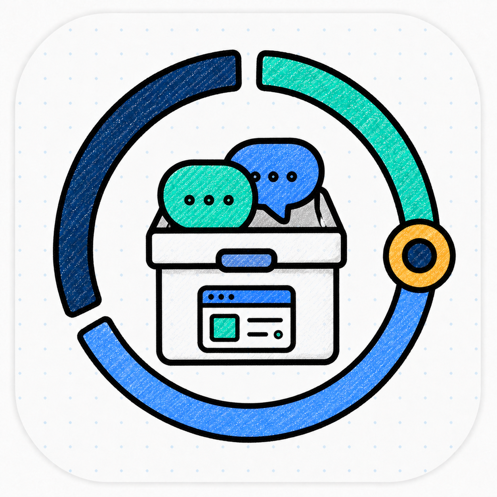

<p align="center">
  
</p>

<p align="center"><strong>English</strong> | <a href="./README.zh-CN.md">中文</a></p>

<h1 align="center">OPL Session Vault</h1>

<p align="center"><strong>Session analytics and recoverable archives.</strong></p>

OPL Session Vault is the local-first projection, Tokscale aggregation, and
full-fidelity Codex archive job for OPL Fleet.

The default product contract is deliberately narrow: build a compact,
reproducible analytics projection from every approved Fleet node, keep Tokscale
away from live client roots, and submit once from the controller. Complete
conversation archives are a separate, explicit workflow.

## Responsibilities

| Owner | Responsibility |
| --- | --- |
| OPL Fleet | Node inventory, network routes, admission, dispatch, and artifact transport |
| OPL Session Vault | Projection semantics, imports, stable analytics copies, Tokscale execution, and Codex archives |
| Tokscale | Downstream usage calculation and submission |
| Codex, Gemini CLI, OpenClaw, Antigravity IDE, ZCode | Their own live session roots and APIs |

There is one cross-machine path and one Tokscale view. Both are owned by this
repository rather than duplicated in local machine configuration.

## Install

The application catalog identifies this product as **OPL Session Vault**,
with Package ID `agent-session-vault` and version from `opl-package.json`.
Use OPL Software Center or its CLI for the released Package:

```bash
opl packages install agent-session-vault --json
opl packages status --package-id agent-session-vault --json
opl packages update agent-session-vault --json
```

The publication source is
`ghcr.io/gaofeng21cn/one-person-lab-packages/agent-session-vault`.
Each immutable artifact binds an annotated owner tag. The native plugin manager
owns installed bytes; removal preserves configuration, sessions, projections,
and archives. Archive, prune and submission operations retain their own authority.

The Package includes the CLI source and `vault.py` entrypoint, and requires
Python 3.12 or later. Agent invocation needs no separate global CLI installation.
For terminal development, an explicit checkout may use
`uv tool install --python 3.12 --editable .`; that is a developer override,
not a software-center release channel. Remove only that separate CLI with
`uv tool uninstall agent-session-vault`.

Create the local configuration:

```bash
mkdir -p ~/.config/agent-session-vault
cp config/agent-session-vault.example.toml \
  ~/.config/agent-session-vault/config.toml
agent-session-vault config --json
```

Real machine paths, archive locations, receipts, projections, and session data
stay outside the repository.

## Routine Use

Refresh the controller and every approved Fleet node:

```bash
agent-session-vault sync fleet --json
```

Inspect or run Tokscale against the managed projection:

```bash
agent-session-vault tokscale env --json
agent-session-vault tokscale exec -- submit -c codex,gemini,openclaw,antigravity,zcode --dry-run
```

Run the complete daily sync and single-submit workflow:

```bash
agent-session-vault ops daily-tokscale --mirror-stable --json
```

Archive full Codex sessions without deleting local sources:

```bash
agent-session-vault archive init --json
agent-session-vault ops archive-cycle --due-only --deep --json
```

Local pruning and restore are plan-driven, explicit operations. See the
operations guide before using them.

## Current Guarantees

- Tokscale reads only the managed projection and managed extras, never live
  client roots.
- The controller performs one aggregate submit; Fleet nodes do not submit
  independently.
- Imported projections retain accumulated usage history when an upstream node
  removes old files.
- The stable layer is a restore copy for analytics continuity, not a routine
  runtime input.
- Full-fidelity archives are immutable snapshot objects with catalog, deep
  verification, staging restore, and guarded local pruning.
- Cloud-synced or NAS directories are storage locations, not live client roots.

## Documentation

- [Documentation ownership and lifecycle](docs/README.md)
- [Operations guide](docs/en/OPERATIONS.md)
- [Configuration reference](docs/en/CONFIGURATION.md)
- [Architecture](docs/en/ARCHITECTURE.md)
- [中文操作手册](docs/zh/OPERATIONS.md)
- [中文配置参考](docs/zh/CONFIGURATION.md)
- [中文架构说明](docs/zh/ARCHITECTURE.md)
- [Primary Agent Skill](skills/agent-session-vault/SKILL.md)

## Validate

```bash
ruff check .
python3 -m pytest
```

Licensed under the [Apache License 2.0](LICENSE).
